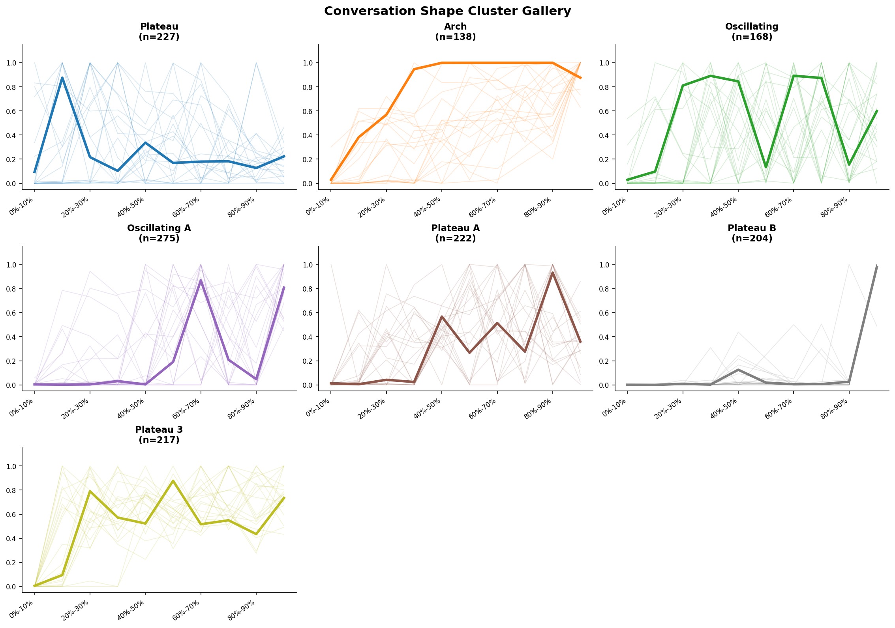
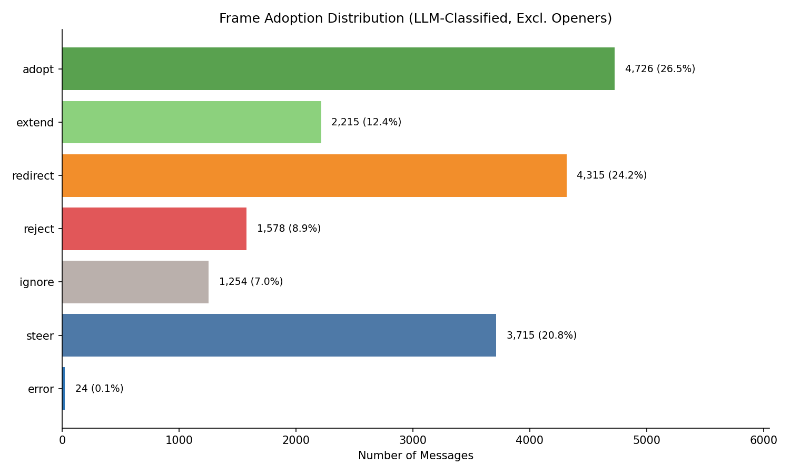
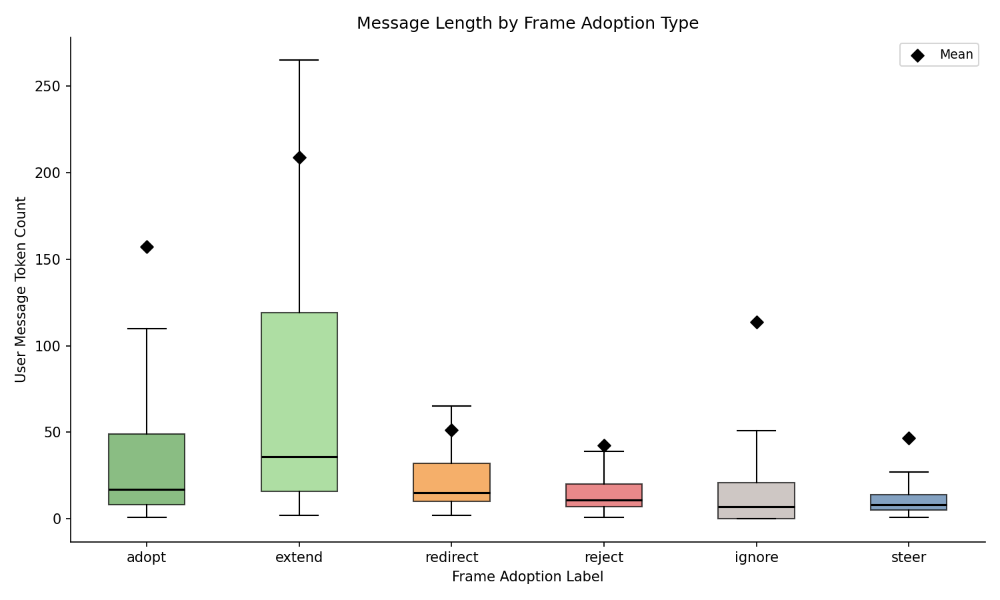
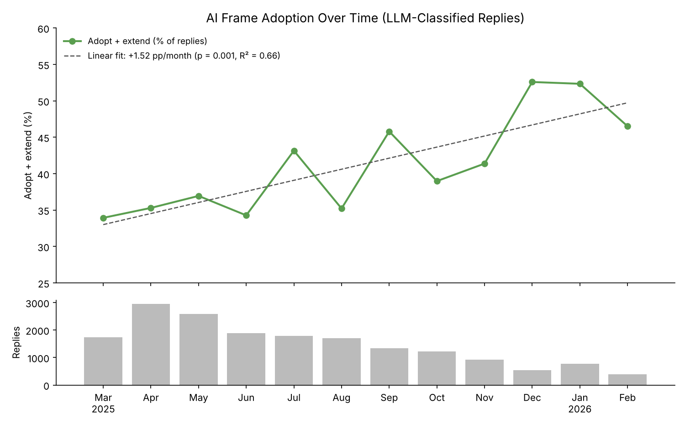
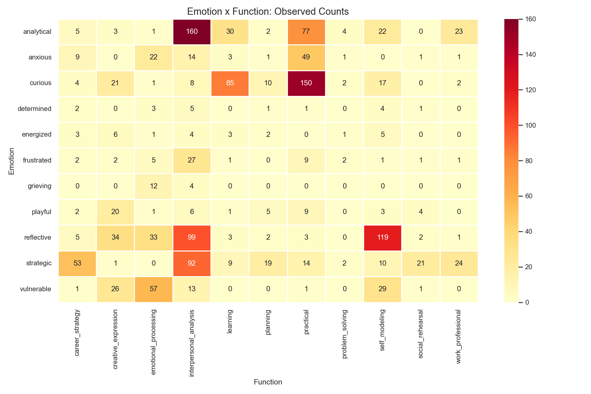
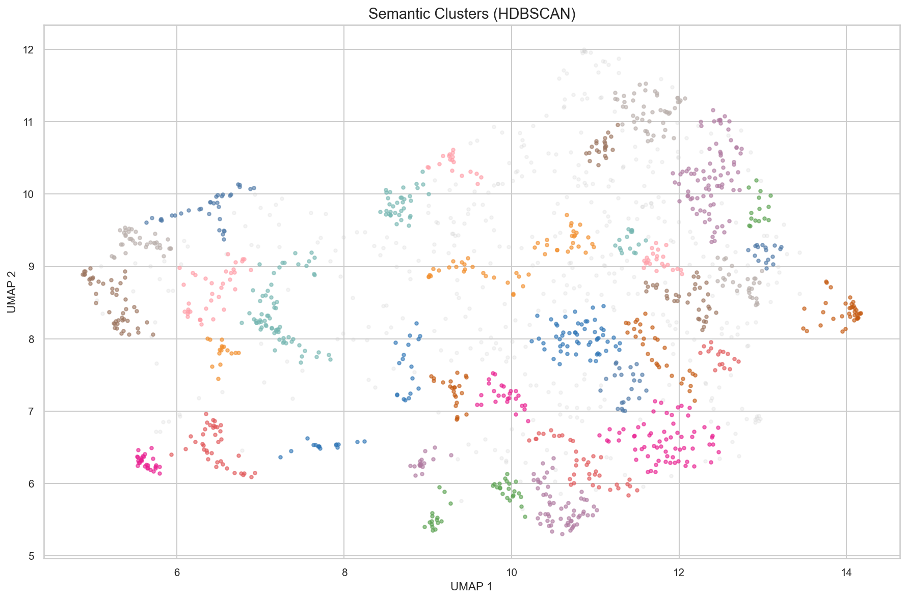
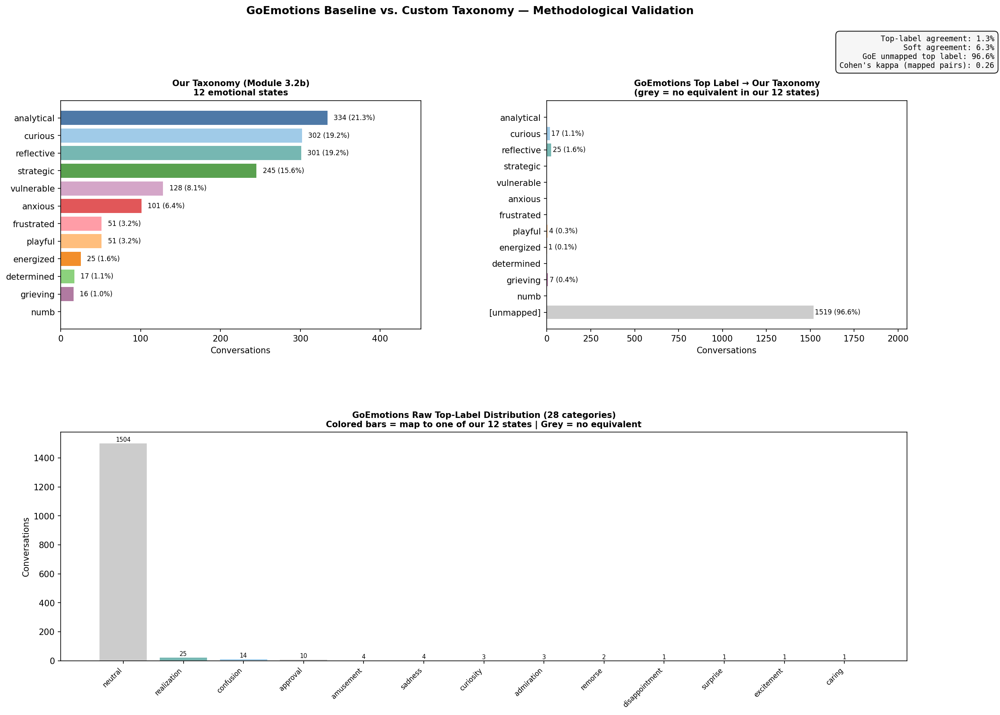

# SUBTEXT

**Longitudinal NLP research on a personal corpus of 1,573 AI and human conversations.**

research log: https://www.notion.so/32c77cb7d15d81e88606ecec5566e59f

This project applies computational linguistics to a personal corpus of conversational data collected over 11 months (March 2025 – February 2026). The analysis spans structural, thematic, and longitudinal dimensions.

---

## The Corpus

1,573 conversations. ~11 months.

The raw data is a ChatGPT export — a ZIP archive containing `conversations.json`, where each conversation is a DAG (directed acyclic graph) of message nodes, not a flat array. Conversations with edits or regenerations have branching paths. The extraction pipeline linearizes these DAGs using a last-child-at-branch heuristic and flags branching conversations for separate analysis.

---

## Pipeline

The project runs as a sequential pipeline. Each step reads from the output of the previous step and writes structured output (Parquet, JSON, HTML) to `outputs/`.

| # | Script | Question |
|---|--------|----------|
| 01 | `extract` | Can I reliably decompress, parse, and linearize a DAG-structured ChatGPT export? |
| 02 | `parse` | What does the corpus look like as structured data? (→ `messages.parquet` + `conversations.parquet`) |
| 03 | `clean` | What's broken? Nulls, duplicates, truncations, encoding, empty conversations, plugin artifacts. |
| 04 | `edge_cases` | What doesn't fit? Massive paste-ins, multi-modal content, custom GPT sessions, tool-role messages. |
| 04b | `report` | Data inventory dashboard — temporal heatmaps, volume time series, length distributions, role ratios. |
| 05 | `enrich` | Token counts (tiktoken cl100k_base), code detection, quality scores, timestamp normalization. |
| 06 | `pii_scan` | PII detection — spaCy NER + regex patterns for names, emails, phone numbers, workplaces. Flags affected messages (`has_pii`) and saves detections locally; does not redact text. |
| 07 | `quality_report` | Automated quality audit — % null per column, completeness scores, coverage validation. |
| 08 | `turn_dynamics` | How do conversations flow? Token ratios, message length per turn position, engagement intensity. |
| 09 | `conversation_shapes` | What shapes do conversations take? Cluster by length vector using DTW + k-means (deepening, plateau, spiral). |
| 10 | `opening_taxonomy` | How do conversations begin? Classify first user message — question, command, statement, fragment, code — via spaCy POS tagging. |
| 11 | `topics` | What latent thematic structure exists, and how do themes shift over time? BERTopic + sentence-transformers + UMAP + HDBSCAN. |
| 12 | `summarize` | Compression layer — conversation-level summaries for downstream analysis. |
| 13b | `functional_classify` | What is the user doing in each conversation? Taxonomy-aware functional classification via Claude Haiku Batch API. Loads categories from JSON via `--taxonomy-path`. |
| 14b | `emotional_state` | What emotional states appear across conversations? Taxonomy-aware classification (compared against a GoEmotions baseline in step 15). Loads categories from JSON via `--taxonomy-path`. |
| 15 | `goemotions_baseline` | Local GoEmotions transformer baseline — zero-API-cost emotion detection for comparison with LLM classifications. |
| 16 | `length_weight_analysis` | How do count-based vs message-weighted distributions differ? Reveals categories inflated by short conversations. |
| 17 | `frame_adoption` | How does the user respond to AI framing? Message-level classification of adopt/extend/redirect/reject/ignore/steer. |
| 18 | `vocab_transfer` | Which AI words and phrases permanently entered the user's vocabulary? Corpus-level NLP via spaCy + wordfreq — no API calls. |
| 19 | `hypothesis_extraction` | What predictions, intuitions, assessments, and interpretations did the user express? Two-pass Batch API extraction with referent resolution. |
| 20 | `belief_trajectories` | How do beliefs form, evolve, persist, and dissolve over time? Thread clustering + provenance classification + frame adoption overlay. |
| 20b | `consolidate_threads` | Merge redundant belief threads via LLM-assisted consolidation. |
| 21 | `corpus_discovery` | What research questions does this corpus raise? Open-ended LLM analysis of each conversation with no prior enrichment — 4,616 suggestions generated blind. |
| 22 | `entity_attention` | Who does the user talk about, when, and how much? spaCy NER + targeted regex for person tracking. Weekly time series with PELT changepoint detection. Zero API cost. |
| 23 | `prediction_resolution` | Of 898 extracted predictions, which came true? Evidence-matched against later conversations via Haiku batch API. 66.2% accuracy on resolvable predictions. **Note: resolution accuracy has room for improvement** — the prompt handles most cases well but still misclassifies some self-assessments as predictions, and occasionally treats absence of evidence as disconfirmation. See `outputs/reports/prediction_outcomes.csv` for manual review. |
| 25 | `cross_dimensional` | What relationships exist between emotional states, functional classifications, entity attention, conversation shapes, frame adoption, and opening types? Joins all enrichment layers and runs chi-squared, ANOVA, and correlation tests. Zero API cost. |
| 26 | `embeddings` | Conversation-level embeddings (sentence-transformers) → FAISS vector store for semantic search and retrieval. Zero API cost. |
| — | `taxonomy_discovery` | Stage 1 of adaptive taxonomy: LLM-driven category discovery from a stratified sample. Proposes 8-15 categories with entropy diagnostics. Claude Sonnet direct API. |
| — | `taxonomy_review` | Stage 2 of adaptive taxonomy: generates markdown review report comparing proposed taxonomy against defaults — diffs, possible renames, split candidates. |

### Planned

| # | Module | Question |
|---|--------|----------|
| — | `knowledge_graph` | What does the relational structure of a personal corpus look like extracted purely from language? spaCy + NetworkX + Louvain. |
| — | `longitudinal` | How does cognition change over time? Vocabulary evolution, complexity metrics, inflection detection (PELT via ruptures). |

---

## Sample Results

Aggregate outputs from running the pipeline on the full corpus. No message text is shown.

### Conversation shapes (`09_conversation_shapes`)



Conversations clustered by how normalized message length changes across each tenth of the conversation (DTW + k-means). Thin lines are sample conversations; the bold line is the cluster centroid.

### Frame adoption (`17_frame_adoption`)



How each user message responds to the AI's framing in the previous turn: adopt, extend, redirect, reject, ignore, or steer. LLM-classified, excluding conversation openers (n = 17,827).



User message length by frame adoption type. Replies that extend the AI's framing are the longest (median 36 tokens, mean 209). Redirect, reject, ignore, and steer replies are short (medians 7–15 tokens); the high means for adopt and ignore come from a small number of very long messages.

#### Influence profile

| Response pattern | Labels | Share of replies |
|------------------|--------|------------------|
| Follows the AI's framing | adopt + extend | 38.9% |
| Pushes back on it | redirect + reject | 33.1% |
| Sets own direction | steer + ignore | 27.9% |



The share of replies that adopt or extend the AI's framing rose over the 12 months, from 36.4% in the first six months to 45.1% in the last six (linear fit across monthly rates: +1.52 percentage points per month, p = 0.001, R² = 0.66). Two caveats: the period overlaps with several ChatGPT model upgrades, so the trend may reflect changes in the models as well as the user, and monthly volume fell from a peak of about 2,900 replies (April 2025) to under 400 (February 2026), so later months are noisier.

### Emotion × function (`25_cross_dimensional`)



Conversations cross-tabulated by primary emotional state (`14b`) and primary function (`13b`). Categories with fewer than 10 conversations (here, `coding`) are omitted. The two dimensions are moderately associated: χ² = 1776.8, df = 100, p < 0.001, Cramér's V = 0.34, n = 1,562.

### Semantic clusters (`26_embeddings`)



Each point is one conversation, embedded from its summary (`12_summarize`) with `all-mpnet-base-v2`, projected to 2D with UMAP (cosine), and clustered with HDBSCAN on the 2D coordinates (min cluster size 15). HDBSCAN found 36 clusters; gray points (26.5%) are unclustered. Colors repeat across clusters.

### GoEmotions baseline vs. custom taxonomy (`15_goemotions_baseline`)



`SamLowe/roberta-base-go_emotions` (28 labels, run locally) applied to the same 1,573 conversation summaries, compared with the emotional states assigned in `14b`. GoEmotions labels 1,504 summaries `neutral`, so top-label agreement is 1.3% (soft agreement 6.3%; Cohen's κ = 0.26 on the 54 conversations where both labels map to a shared category). Rather than validating the custom taxonomy, the comparison shows the limits of a general-purpose emotion model trained on Reddit comments: it has no equivalent for the analytical and strategic states (37% of conversations) and labels nearly everything else `neutral`.

---

## Data Architecture

```
chatgpt_export.zip
│
├── 01_extract    → raw_conversations.json
├── 02_parse      → messages.parquet + conversations.parquet
├── 03_clean      → messages_clean.parquet + quality_report.json
├── 05_enrich     → messages_enriched.parquet
├── 06_pii_scan   → has_pii flags + pii_scan_report.json
│
├── 08-10         → structural_report.json + figures/
├── 11_topics     → topic_model/ + topic_viz.html
├── 12_summarize  → summaries.parquet
│
├── 13_functional → functional_classifications.parquet
├── 14_emotional  → emotional_states.parquet
├── 15_goemotions → goemotions_baseline (local transformer)
├── 16_length_wt  → weighted distribution figures
├── 17_frame      → frame_adoption.parquet
├── 18_vocab      → vocab_transfer.parquet
├── 19_hypothesis → hypotheses.parquet + hypothesis_catalog.csv
├── 20_belief     → belief_threads.parquet + belief_provenance.parquet + belief_thread_summaries.parquet
├── 21_discovery  → corpus_discovery.parquet (1-3 research questions/observations per conversation)
│
├── 22_entity     → entity_attention.parquet + entity_attention_weekly.parquet + 7 figures
├── 23_prediction → prediction_outcomes.parquet + prediction_outcomes.csv
├── 25_cross_dim  → cross_dimensional_merged.parquet (63-col master frame) + 15 figures
└── 26_embeddings → conversation_embeddings.faiss + embedding_metadata.parquet
```

### Core Schemas

**messages.parquet**

| Column | Type | Description |
|--------|------|-------------|
| conversation_id | string | FK to conversations table |
| msg_index | int32 | Position in linearized thread |
| role | category | system \| user \| assistant \| tool |
| text | string | Concatenated text from content.parts |
| timestamp | datetime64 | UTC |
| token_count | int32 | tiktoken cl100k_base estimate |
| has_code | bool | Contains markdown code fences |
| has_attachment | bool | Non-text content in parts |
| is_branched | bool | Conversation had edits/regenerations |

**conversations.parquet**

| Column | Type | Description |
|--------|------|-------------|
| conversation_id | string | Primary key |
| title | string | Auto-generated or null |
| created_at | datetime64 | First message timestamp (UTC) |
| duration_minutes | float32 | Last - first message |
| msg_count | int32 | Total messages |
| user_msg_count | int32 | User messages only |
| user_token_total | int32 | Sum of user token counts |
| assistant_token_total | int32 | Sum of assistant token counts |
| hour_of_day | int8 | Hour of creation (local TZ) |
| has_code | bool | Any message contains code |

---

## Streamlit App

A multi-page web interface for exploring the corpus interactively. Run with `streamlit run subtext/app.py`.

| Page | Description |
|------|-------------|
| Semantic Search | FAISS-powered similarity search across conversation embeddings. |
| Semantic Map | 2D UMAP projection of all conversations, colored by functional/emotional category. |
| Entity Explorer | Browse entity attention over time — who gets talked about, when, and how much. |
| Timeline | Temporal exploration of conversations with filtering by category, era, and date range. |
| Conversation Reader | Read full conversation transcripts with metadata sidebar. |

---

## Adaptive Taxonomy System

The default classification taxonomies (12 functional categories, 12 emotional states) are hardcoded baselines. The adaptive taxonomy system enables corpus-specific category discovery without modifying original pipeline scripts.

**Stage 1 — Discovery:** `taxonomy_discovery.py` draws a stratified sample by model era, sends it to Claude Sonnet, and receives proposed categories with estimated frequencies. Shannon entropy flags low-diversity taxonomies (< 2.0 bits) and dominant categories (> 25%).

**Stage 2 — Review:** `taxonomy_review.py` generates a markdown report comparing the proposed taxonomy against the default — shared categories, additions, removals, possible renames, split candidates.

**Stage 3 — Classification:** After human review and approval, the taxonomy-aware classifiers (`13b`, `14b`) load categories from the approved JSON file via `--taxonomy-path` and run Batch API classification as usual.

Taxonomy JSON files are stored locally in `subtext/taxonomies/` (gitignored). The shared module `subtext/taxonomy.py` handles loading, validation, and dynamic prompt generation.

---

## Technical Stack

| Layer | Package | Purpose |
|-------|---------|---------|
| Core | Python 3.11+ | Runtime |
| Data | pandas, pyarrow | DataFrame ops + Parquet I/O |
| NLP | spaCy (en_core_web_trf) | Tokenization, POS, dependency parsing, NER |
| Tokenization | tiktoken | GPT token estimates (cl100k_base) |
| Embeddings | sentence-transformers | BERTopic embeddings for topic modeling |
| Topic Modeling | BERTopic + HDBSCAN + UMAP | Unsupervised thematic clustering |
| Sentiment | vaderSentiment | Coarse sentiment baseline |
| Word Frequency | wordfreq | Baseline lexical frequency for vocab transfer detection |
| Visualization | plotly, matplotlib | Interactive timelines + static figures |
| LLM | anthropic SDK | Claude Batch API for qualitative classification |


## Where This Is Headed

This project is the foundation for a broader research direction: **recursive meaning systems** — modeling how meaning forms, propagates, and revises itself across conversations, people, and time.

"Memory is not a recording, its a rewriting that never stops" -Frederic Bartlett

---
